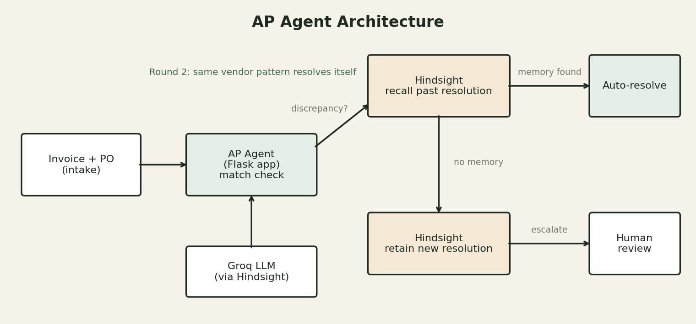

# AP Agent: Accounts Payable Exception Handler with Memory (Hindsight)

An AI agent for accounts payable teams that **remembers how past invoice
exceptions were resolved**, so recurring vendor patterns stop needing a
senior accountant.

Built with [Hindsight](https://github.com/vectorize-io/hindsight) (agent memory by Vectorize) and Groq (LLM).

## The problem
AP teams process thousands of invoices. Many don't match their Purchase Order
for harmless, recurring reasons: a vendor adds a handling fee, applies an
early-payment discount, or rounds a conversion. Every time, a junior clerk
escalates it and a senior accountant explains, again, that it is fine.

## The solution
1. Invoice arrives and is compared to its PO.
2. Exact match: auto-approved.
3. Discrepancy: the agent asks Hindsight (`recall`) whether this vendor and
   pattern have been resolved before.
   - **Found:** auto-resolved using the remembered resolution.
   - **Not found:** escalated to a human. The human's answer is saved with
     Hindsight (`retain`), so it never needs escalating again.
4. `reflect` asks Hindsight to summarize every pattern the agent has learned.

**Before memory:** every exception looks new. **With memory:** the agent
improves with every resolution, like a real employee.

## Architecture


## Tech stack
- Python + Flask (web dashboard and API)
- Hindsight (memory: `retain`, `recall`, `reflect`), embedded via `hindsight-all` (Docker and Cloud also supported)
- Groq (`openai/gpt-oss-120b`) as the LLM behind Hindsight
- Vanilla HTML/JS front end

## Setup instructions (no Docker needed)

### Prerequisites
- Python 3.10+ 
- A free Groq API key: https://console.groq.com  (API Keys -> Create)

### 1. Install
```bash
pip install -r requirements.txt
```
(`hindsight-all` runs Hindsight embedded inside Python, so there is no Docker.)

### 2. Set your Groq key
Windows PowerShell:
```powershell
$env:GROQ_API_KEY="your-groq-key-here"
```
Mac/Linux:
```bash
export GROQ_API_KEY=your-groq-key-here
```

### 3. Run
```bash
python app.py
```
The first start downloads and initializes Hindsight, which can take a few
minutes. Wait for `Embedded Hindsight running at ...`.

### 4. Open the dashboard
http://localhost:5000

### Alternative backends (optional)
- **Docker:** run the Hindsight container, then set `HINDSIGHT_URL=http://localhost:8888`
  ```bash
  docker run --rm -it -p 8888:8888 -p 9999:9999 \
    -e HINDSIGHT_API_LLM_PROVIDER=groq -e HINDSIGHT_API_LLM_API_KEY=$GROQ_API_KEY \
    -e HINDSIGHT_API_LLM_MODEL=openai/gpt-oss-120b \
    -v $HOME/.hindsight-docker:/home/hindsight/.pg0 ghcr.io/vectorize-io/hindsight:latest
  ```
- **Hindsight Cloud:** set `HINDSIGHT_API_KEY` from https://ui.hindsight.vectorize.io

## How to use the demo
1. Click **Process next invoice**. Acme Supplies and Bright Traders have
   discrepancies Hindsight has not seen, so you type a resolution for each.
2. Round 2 starts with the same invoices. Hindsight recalls the resolutions
   and they are **auto-resolved with no human input**.
3. Click **Ask Hindsight to reflect** to see what the agent has learned.

## Screenshots
See the `screenshots/` folder.

## Demo
See the `demo/` folder, or the video link: _add your YouTube link here_

## Project structure
```
app.py             Flask app + Hindsight integration + dashboard
requirements.txt   Python dependencies
.env.example       Environment variable template
architecture.png   System diagram
screenshots/       Dashboard screenshots
demo/              Demo video / link
```

## Team
_Add team member names here._
